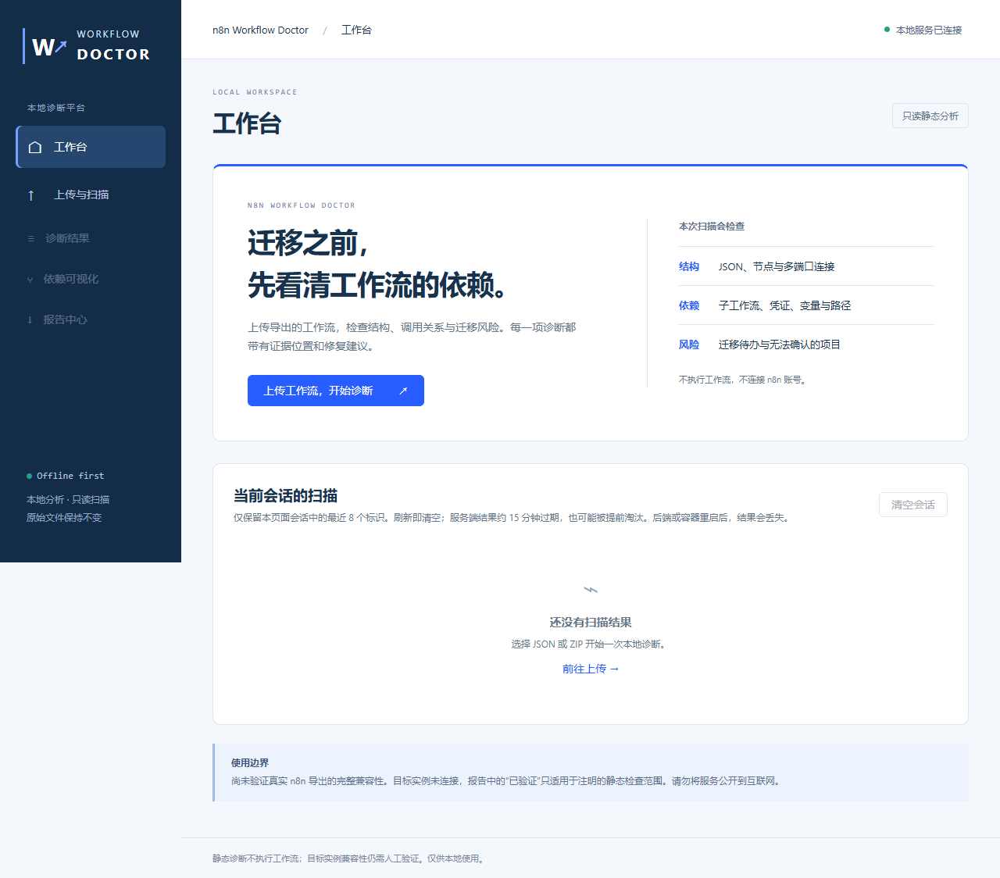

# n8n Workflow Doctor

[简体中文](README.md) | **English**

[](https://github.com/spongia9/n8n-workflow-doctor/actions/workflows/tests.yml)

An offline, read-only n8n workflow diagnostic tool. Inspect JSON/ZIP structures, call dependencies and migration risks before import. Includes a native Windows workbench and CLI. Not affiliated with n8n.

## Features

- Single/multiple JSON, recursive directories and bounded ZIP import.
- Nodes, multi-port connections, sub-workflows, Error Workflow, credentials, variables, paths and shared references.
- Scoped assessments, distinct Finding IDs, rule explanations and redacted evidence locators.
- Group by workflow, node or rule; separate internal and cross-workflow graphs.
- JSON, Markdown, HTML and Text reports from the same engine used by FastAPI and CLI.

Never executes workflows, expressions or Code nodes; never visits input URLs, reads referenced files, connects n8n accounts or performs migration.



## Native Windows startup

Install Python **3.12** with the py launcher and Node.js **24.19+ within 24.x**, then run in the project root:

```powershell
powershell.exe -NoProfile -ExecutionPolicy Bypass -File .\start.ps1 -Prepare
```

Preparation creates/uses a venv, installs hash-locked dependencies, runs npm ci and builds Vue. Package access is needed during preparation. FastAPI serves the production frontend; no Vite, Docker, WSL or Linux is required at runtime.

Open the [workbench](http://127.0.0.1:8080) or [Swagger](http://127.0.0.1:8080/docs). Select JSON files or one ZIP and explicitly confirm the upload.

```powershell
powershell.exe -NoProfile -ExecutionPolicy Bypass -File .\start.ps1
powershell.exe -NoProfile -ExecutionPolicy Bypass -File .\status.ps1
powershell.exe -NoProfile -ExecutionPolicy Bypass -File .\stop.ps1
```

For an occupied port use start.ps1 -Port 8081. Stop requests graceful exit only for the owned instance, never kills by port. See [deployment](docs/DEPLOYMENT.md).

## Interpreting diagnostics

Check count includes pass and not-applicable. Problem Finding count includes blocker, risk and unknown; unique rules are counted separately. Unresolved static references and unique target nodes have distinct counts. Dynamic expressions never create fictional targets or edges.

Static pass does not mean successful execution. Missing From Import Set does not mean absent on the destination. Names, IDs, parameters and original upload filenames are redacted by default; locate evidence using source aliases, node positions/types and fingerprints.

## CLI

Use an installed Python environment; core-only users can run pip install -e .:

```powershell
python -m workflow_doctor scan tests/fixtures/valid.json
python -m workflow_doctor analyze examples/sprint2-formal/workflows --format json
python -m workflow_doctor analyze examples/sprint2-formal/workflows --format html --output reports/review.html
```

Exit codes: 0 for no implemented review findings; 1 for structural findings, risks or unknown dependencies; 2 for arguments, resource or input failures. Existing output files are never overwritten.

## Architecture

Browser → FastAPI → shared Scanner / Parser / rules / NetworkX → redacted result → four reports. CLI calls the same engine. The frontend does not repeat graph algorithms; the core has no HTTP dependency.

## Security and limits

Loopback-only, without authentication or public-hosting assurance. Results expire after roughly 15 minutes or earlier eviction and disappear on restart; old IDs return 404. Upload originals are not persisted. Download needed redacted reports first.

ZIP path/count/size/decompression guards, escaped HTML, restrictive CSP and sandboxed previews are retained. See [security](docs/SECURITY.md).

## Verification

Version **0.1.0**. Local Windows/Python 3.12.13/Edge record dated 2026-11-16: 313 backend and 55 Vitest tests; browser suites separately passed 15 (14 live API + 1 mock), 17 (reusing the first 14), 1 real hostile-HTML HTTP case and 2 production-interaction cases. Typecheck, build and OpenAPI checks passed locally; this is not remote CI evidence.

[Remote CI passed on 2026-11-16](https://github.com/spongia9/n8n-workflow-doctor/actions/runs/43830078427): all five Windows/Linux backend, frontend, Chromium integration and native Windows jobs succeeded. Remote interpreters were Python 3.12.10 on Windows and 3.12.16 on Linux. Optional Docker validation was not run and is not certified by these results.

Authorized real-export compatibility remains unverified. All public fixtures are fabricated, and destination import/execution is not certified. See [testing](docs/TESTING.md) and [compatibility](docs/COMPATIBILITY.md).

## Documentation

- [Deployment](docs/DEPLOYMENT.md) · [API](docs/API.md) · [Frontend](docs/FRONTEND.md)
- [Diagnostics and rules](docs/DEPENDENCY_ANALYSIS.md) · [Reports](docs/REPORT_FORMAT.md)
- [Fixture provenance](docs/FIXTURE_PROVENANCE.md) · [Roadmap](docs/ROADMAP.md) · [Contributing](CONTRIBUTING.md)

## License

Project source uses the [MIT License](LICENSE). Third-party components retain their own terms: [notices](docs/THIRD_PARTY_NOTICES.md).
