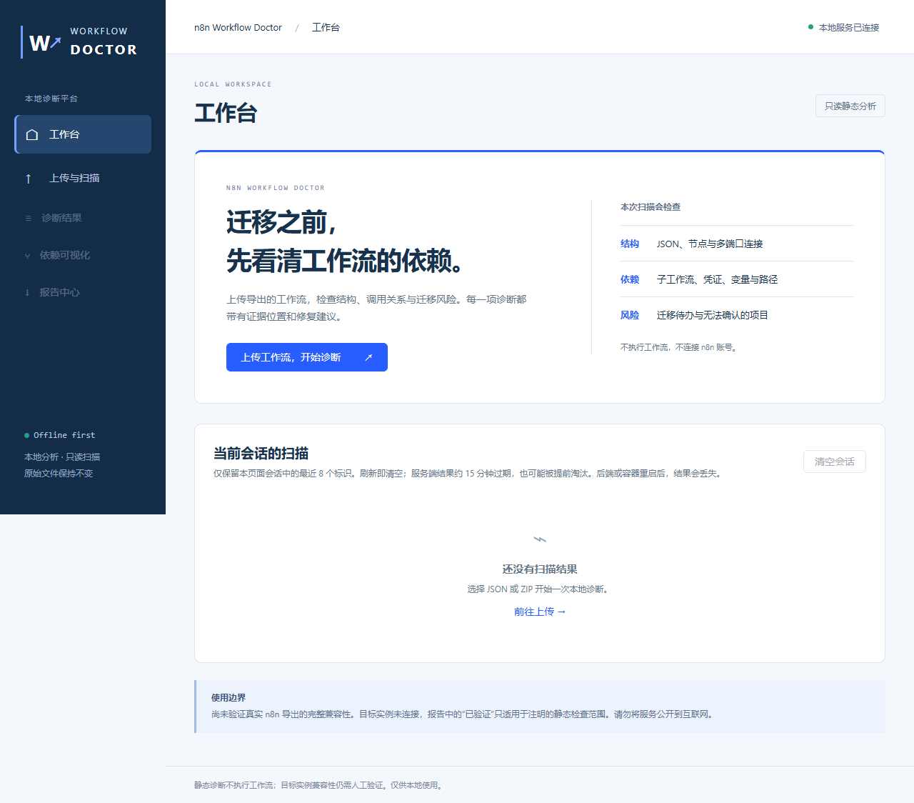

# n8n Workflow Doctor

**简体中文** | [English](README.en.md)

离线、只读的 n8n 工作流诊断工具。在导入或迁移前检查 JSON/ZIP 的结构、调用依赖与迁移风险，提供 Windows 本机诊断台和 CLI。与 n8n 官方无隶属关系。

## 功能

- 单个/多个 JSON、目录递归扫描及安全 ZIP 批量导入。
- 节点、连接、多端口结构检查；子工作流、Error Workflow、凭证、变量、路径与共享资源分析。
- 五类有范围的诊断状态、独立 Finding ID、中文规则说明及证据定位。
- 按工作流、节点、规则分组；内部节点图和跨工作流图分别展示。
- JSON、Markdown、HTML、Text 报告；FastAPI 接口与本地 CLI 共用诊断引擎。

不执行工作流、表达式或 Code 节点，不访问输入 URL，不读取引用文件，不连接 n8n 账号，不自动迁移。



## Windows 快速开始

准备 Python **3.12**（包含 py 启动器）与 Node.js **24.19+ 的 24.x**，在项目根目录运行：

```powershell
powershell.exe -NoProfile -ExecutionPolicy Bypass -File .\start.ps1 -Prepare
```

首次安装会创建/使用虚拟环境、安装哈希锁定依赖、执行 npm ci 并构建前端，需要包仓库网络。运行时由 FastAPI 托管前端生产文件，不需要 Vite、Docker、WSL 或 Linux。

访问 [诊断台](http://127.0.0.1:8080)、[Swagger](http://127.0.0.1:8080/docs)；点击“上传与扫描”，选择 JSON 或一个 ZIP，确认后扫描。

```powershell
powershell.exe -NoProfile -ExecutionPolicy Bypass -File .\start.ps1
powershell.exe -NoProfile -ExecutionPolicy Bypass -File .\status.ps1
powershell.exe -NoProfile -ExecutionPolicy Bypass -File .\stop.ps1
```

端口占用用 start.ps1 -Port 8081。停止只请求本项目实例优雅退出，不按端口强杀其他程序。首次安装/更新详见 [部署指南](docs/DEPLOYMENT.md)。

## 诊断结果

检查总数包含通过和不适用；问题 Finding 总数只计阻断、风险和未知，唯一规则数量另计。静态未解析引用条数与未解析目标数分别展示，同一目标可能有多个调用。动态表达式不创建虚构目标或连线。

“静态检查通过”不代表实际运行成功；“本次导入集合未包含目标”不代表目标实例中不存在。名称、ID、参数和原始上传文件名默认脱敏，通过来源别名、节点位置、类型和指纹定位。

## CLI

安装 api/test 环境后，也可使用 CLI；只用核心功能可安装 `pip install -e .`：

```powershell
python -m workflow_doctor scan tests/fixtures/valid.json
python -m workflow_doctor analyze examples/sprint2-formal/workflows --format json
python -m workflow_doctor analyze examples/sprint2-formal/workflows --format html --output reports/review.html
```

退出码：0 = 已实现检查无待核查项；1 = 存在结构问题、风险或未知依赖；2 = 参数、资源或输入处理失败。报告不覆盖已有文件。

## 架构

浏览器 → FastAPI → 共享 Scanner / Parser / 规则 / NetworkX → 脱敏诊断对象 → 四格式报告。CLI 直接调用同一引擎。前端不重新实现图算法，HTTP 依赖不进入核心。

## 安全与限制

只监听 127.0.0.1，尚无认证和公网访问控制。结果约 15 分钟过期，也可能提前淘汰；停止/重启清空缓存，旧 Scan ID 返回 404。上传原文不持久保存，需先下载脱敏报告。

ZIP 有路径、数量、大小、总解压量等限制；HTML 使用转义、CSP 和无权限 iframe。完整边界见 [安全说明](docs/SECURITY.md)。

## 验证状态

当前版本 **0.1.0**。2026-11-16 本地 Python 3.12.13 / Windows Edge 验证记录：后端 313、Vitest 55；浏览器四套分别为 15（14 真实接口 + 1 Mock）、17（复用前 14）、1 真实恶意 HTML HTTP、2 生产交互。类型、构建与 OpenAPI 契约通过；这些是本地结果，不能代替远程 CI。

授权真实 n8n 导出兼容性仍待验证；所有公开样本均为合成数据。不声称目标环境可导入或可运行。见 [测试说明](docs/TESTING.md) 与 [兼容性记录](docs/COMPATIBILITY.md)。

## 文档

- [部署与排错](docs/DEPLOYMENT.md) · [API](docs/API.md) · [前端开发](docs/FRONTEND.md)
- [诊断与规则](docs/DEPENDENCY_ANALYSIS.md) · [报告契约](docs/REPORT_FORMAT.md)
- [样本来源](docs/FIXTURE_PROVENANCE.md) · [路线图](docs/ROADMAP.md) · [贡献指南](CONTRIBUTING.md)

## 许可证

项目源码采用 [MIT](LICENSE)。第三方组件继续适用其各自许可证，见 [第三方声明](docs/THIRD_PARTY_NOTICES.md)。
